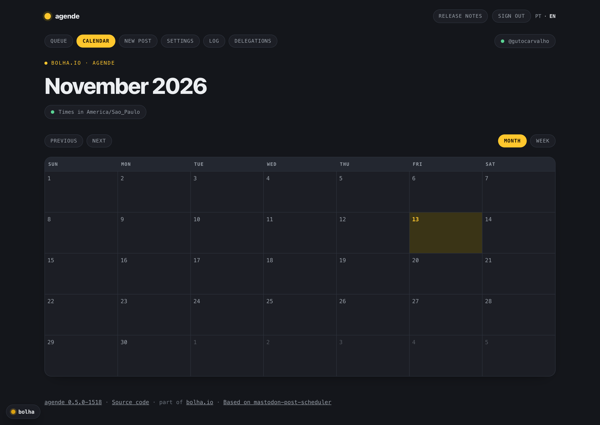
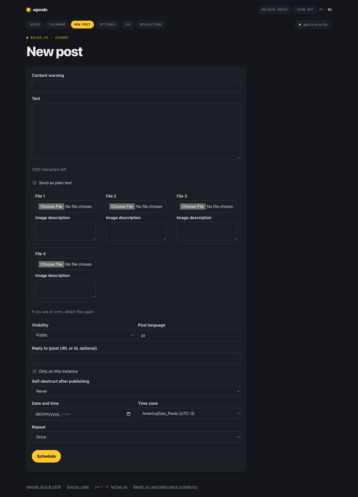

# agende

Schedule posts on one Mastodon instance. People sign in with OAuth, write a post and pick a date. The instance stores and publishes it, so scheduled posts go out even if this app is down.

- Full composer: Markdown, media with descriptions, content warnings, visibility, language, replies
- Queue, weekly and monthly calendar, change date, cancel, duplicate
- Cancel in bulk: selected posts from the queue, or a post and the later ones with the same text
- Repeat daily, weekly or monthly: creates up to 24 regular scheduled posts at once
- Editing a post finds the later posts with exactly the same text, and offers to change them too: each keeps its own date and files
- Optional self-destruct and instance-only posts, for forks that support them
- Activity log page: who scheduled, moved, edited or canceled what, on which account, with filters by account, action and period
- Optional delegation: an account lets another account of the instance schedule posts as it

## Contents

- [Screenshot](#screenshot)
- [Testing and security](#testing-and-security)
- [Architecture](#architecture)
- [Install](#install)
- [Versions](#versions)
- [How it stores data](#how-it-stores-data)
- [Delegation](#delegation)
- [Limits](#limits)
- [Development](#development)
- [License](#license)

## Screenshot

[](https://agende.bolha.us)
[](https://agende.bolha.us)

*A live instance at [agende.bolha.us](https://agende.bolha.us): the monthly calendar and the
composer, PT/EN.*

## Testing and security

agende holds tokens that can post as people, so it is tested against what would hurt: acting on another account's posts, a delegation that outlives its owner's consent, and tokens or post text kept in clear. What is done today (2026-11-08):

**Every pipeline.** GitLab CI ([`.gitlab-ci.yml`](.gitlab-ci.yml), plus the shared security stage from `open/gcn/ci-templates`, file `security.yml`). The test job runs on every pipeline; the security stage runs on every merge request and every push to `main`; the image is built and published only from `main`.

- Blocking (the pipeline fails and no image is published):
  - `go vet`, a `gofmt` check, and the full test suite against real PostgreSQL 17 and Redis 7.4 services (connected as the app's own role, so the grants in `schema.sql` are tested too);
  - `govulncheck`: known vulnerabilities in Go code paths agende actually reaches (in the test job and in the security stage);
  - `gitleaks`: secrets committed to the repository;
  - `trivy`: critical vulnerabilities that have a fix, secrets and misconfigurations in the repository.
- Informative (reported, not blocking): `semgrep`, `gosec`, `hadolint` (Dockerfile), `yamllint`, and `poutine` (security of the CI pipeline itself). The `gosec` findings that are false positives are annotated in the code with the reason.

**The test suite.** 68 tests (`go test -list`). Most drive the real HTTP handlers through sign-in and forms against a fake Mastodon instance, PostgreSQL and Redis; without those services about 48 of them skip, so CI is where they all run. They cover:

- sign-in and forms: OAuth state works once and uses PKCE, CSRF token and same-origin checks, a resent form does nothing, a session sealed with another key is no session, expired tokens are revoked once and a failed revoke is retried;
- ownership: an account can't change, edit or cancel another account's posts, a form acts only on the account it was shown for (another tab may have switched it);
- delegation: only the owner grants it, with the instance's sign-in, and the account that authorized must be the owner; local accounts only, no chains, at most 10 (checked again at the callback); every request checks the database, revoking ends access, the stored token only works for its pair of accounts, a delegate whose own token died stops acting;
- the activity log: who sees which rows (filters never widen it), sentences, filters and pages;
- Mastodon's limits before anything is sent: dates, the daily and total limits, series that would go over them send nothing, daylight saving and month ends in series, one upload per account at a time (and at most 3 at once, counted in memory);
- edits and bulk cancel: an edit creates the new post before canceling the old one and keeps the original if it fails, later posts with the same text keep their own dates and files;
- pages: no inline script or style (the CSP allows none), the Markdown preview escapes HTML, every text in both languages, the release notes.

**Reviews.** A [Strix](https://github.com/usestrix/strix) review found that uploads over 1 MiB left temporary files on the server; fixed in 0.3.1. In 0.4.1 the findings of the updated linters (`gosec`, `semgrep`, `hadolint`) were fixed or annotated. These are what we checked; they are not an outside audit and don't certify anything.

**Reporting a vulnerability.** Write to contato@gutocarvalho.net. Please don't open a public issue for it.

## Architecture

**Why it exists.** Mastodon can schedule posts (`scheduled_at` in its API), but its web interface doesn't offer it. agende is a page for that: write, pick a date, see the queue and a calendar. It doesn't publish anything itself: the instance keeps the scheduled posts and publishes them, so nothing is lost if agende is down at the time.

**In plain words.**

1. the person signs in with their account on the instance (OAuth, PKCE);
2. they write a post and pick a date; agende checks Mastodon's limits and sends it to the instance as a scheduled post, with the person's own token;
3. the queue and the calendar are read from the instance each time; changing the date, editing or canceling are calls to the instance too;
4. each action is written to the activity log.

**Components.**

```
          browser
             |
        agende (this app)
         |      |      \
         |      |       +--> Redis        sessions (8 h, token encrypted), sign-in state,
         |      |                         used form nonces, short locks
         |      +----------> PostgreSQL   settings per account, activity log (excerpts
         |                                encrypted), delegations (owners' tokens encrypted)
         |
         +--> the Mastodon instance (one only, AGENDE_INSTANCE)
               - OAuth sign-in; a second OAuth app for delegation
               - the scheduled posts and their media live here and are published from here
```

- Tokens and log excerpts are encrypted with AES-GCM, each bound to its purpose and owner. Redis never holds a token in clear.
- Every call goes to the one configured instance; a reply is accepted only as an id or a URL of that instance, and agende never fetches a URL someone typed.
- An expired session's token is revoked by a sweep, retried for a week if the instance is down.
- See *How it stores data* below for what is kept and for how long.

## Install

1. Register the OAuth application:

   ```sh
   curl -F client_name=agende \
     -F "scopes=profile read:statuses write:statuses write:media" \
     -F redirect_uris=https://agende.example.social/auth/callback \
     https://example.social/api/v1/apps
   ```

   For delegation, register a second application with the same scopes and its own redirect, and set `AGENDE_DELEGATION_CLIENT_ID`, `AGENDE_DELEGATION_CLIENT_SECRET` and `AGENDE_DELEGATION_KEY` (`openssl rand -hex 32`, not the same as the encryption key):

   ```sh
   curl -F "client_name=agende delegation" \
     -F "scopes=profile read:statuses write:statuses write:media" \
     -F redirect_uris=https://agende.example.social/delegations/callback \
     https://example.social/api/v1/apps
   ```

   It has to be a separate app: Mastodon gives one token per account and app, so with a single app, signing out would revoke the delegation too.

2. Copy `.env.example` to `.env` and fill it in. Put the database admin password in `postgres.env` as `POSTGRES_PASSWORD=...`, so the app never receives it.

3. Start the database and apply the schema as its owner. The app user can't change the schema, and can only add to the audit log:

   ```sh
   docker compose up -d postgres redis
   docker compose exec postgres psql -U postgres -d agende -c "CREATE ROLE agende LOGIN PASSWORD 'change-me'"
   docker compose exec -T postgres psql -U postgres -d agende < schema.sql
   ```

4. `docker compose up -d`, and point your reverse proxy at `127.0.0.1:8080`. It must serve HTTPS, because the session cookie needs it, and accept uploads as large as `AGENDE_MAX_UPLOAD_MB`.

## Versions

Versions look like `X.Y.Z-BUILD`. `X.Y.Z` is in the `VERSION` file and follows SemVer, and `BUILD` is the GitLab pipeline number. A local build shows `X.Y.Z-dev`. The page footer shows the version and links to the [container registry](https://gitlab.gutocarvalho.net/images/agende/container_registry).

What changed in each version is in [CHANGELOG.md](CHANGELOG.md), which the app also serves as its release notes page (`/release-notes`, linked at the top of the page) and as `/release-notes.json`. Add an entry when you bump `VERSION`: a test fails without it.

| Image tag | Moves? |
|---|---|
| `X.Y.Z-BUILD` | Never. Pin this one in production. |
| `X.Y.Z` | On each build of that version. |
| `latest` | On each build. |

## How it stores data

| Where | What |
|---|---|
| Mastodon | The scheduled posts, including text and media |
| Redis | Sessions, with the access token encrypted. A session lasts 8 hours. The token is revoked at sign-out or when it expires, retrying for a week if the instance is down |
| PostgreSQL | Settings per account, the audit log and, with delegation on, the owners' tokens, encrypted |

The audit log covers scheduling, date changes, edits, cancellations and delegation events, and the Log page shows it as sentences. An account sees everything done on it, by itself or a delegate; a delegate sees what it did on other accounts, even after losing access, and the delegation events that name it. It keeps who did what, on which account and when, plus an encrypted excerpt of up to 80 characters, because a canceled post no longer exists on the instance. It only sees actions made here, not ones made directly on Mastodon. Remove old rows with a separate database user: the app can't.

Losing the encryption key or the Redis data signs everyone out, and those tokens can't be revoked from here: people can remove them under Authorized apps on the instance. A lost key also makes stored excerpts unreadable. Scheduled posts aren't affected.

## Delegation

An account, say @news, opens Delegations, names a local account, say @ana, and confirms with its password on the instance. From then on @ana sees "Post as" and can schedule, duplicate, edit and cancel scheduled posts of @news. Posts go out from @news.

- Only the owner grants it, signed in as the owner. The instance asks for the password again, and the app checks that the account that authorized is the one signed in.
- Linked by account id, so a renamed or recreated account doesn't inherit it. Local, active accounts only, up to 10 per owner. A delegate can't pass access on.
- The owner revokes it under Delegations, and the delegate can give it up. Removing the delegation app under Authorized apps on the instance ends every delegation of that account. Scheduled posts stay in the owner's queue.
- Every request checks the delegation in the database again. Every action is in the audit log with the account that did it and the account it was done for.
- The owner's token is stored in PostgreSQL, encrypted with `AGENDE_DELEGATION_KEY` and bound to the pair of accounts. Unlike sessions, it doesn't expire until revoked. It has the same scopes as sign-in, so a leaked token could also read the owner's private posts: there is no smaller scope that lists scheduled posts.

Upgrading from 0.2: apply `schema.sql` again as the database owner before starting 0.3. It adds the `delegations` table and two audit columns, and leaves the rest as it is.

## Limits

These come from Mastodon: at least 5 minutes ahead, 25 scheduled posts per day (UTC) and 300 in total. Mastodon only lets the date of a scheduled post change. Editing anything else creates a new scheduled post and then cancels the old one, keeping its media; the new post gets a new id. Media isn't copied when duplicating.

## Development

```sh
go test ./...
```

Tests that need PostgreSQL and Redis skip themselves unless `AGENDE_TEST_DB_HOST` and `AGENDE_TEST_REDIS` are set, see `.gitlab-ci.yml`. They delete rows and flush a Redis database, so they refuse a PostgreSQL database whose name doesn't end in `_test` and Redis database 0 (they use 15 unless `AGENDE_TEST_REDIS_DB` says otherwise).

Before changing the code, with or without a coding agent, read [AGENTS.md](AGENTS.md): the commands to run the tests against throwaway PostgreSQL and Redis containers, a map of the files, and the rules a change must keep (one instance only, each account acts only on its own posts, delegation checks, who sees the activity log, no inline script, both languages), each with the test that guards it.

## License

AGPL-3.0, see `LICENSE` and `NOTICE`.
